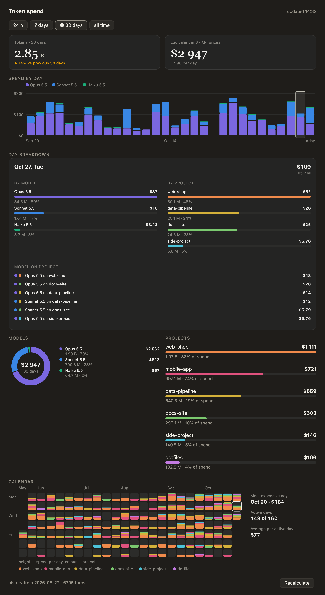

# token-spend

A token-spend panel for Claude Code: how much you spent today, over 7 days, a month and all time; which models and projects used the most; and what it would cost at API prices.

<picture>
  <source media="(prefers-color-scheme: light)" srcset="assets/panel-light.png">
  
</picture>

The screenshots show invented projects and numbers.

- tiles: tokens and dollar equivalent for the period;
- spend-per-day chart, with a breakdown of any day by model and project;
- click a project and the charts and calendar recompute for it;
- a calendar coloured by project;
- `/tokens` opens the panel.

The panel speaks English or Russian, following Claude Code's `language` setting, then the system locale (English otherwise).

## Install

In Claude Code:

```
/plugin install token-spend --marketplace maxoxon/token-spend
```

From a shell:

```
claude plugin install token-spend --marketplace maxoxon/token-spend
```

In the Claude desktop app: "+" next to the prompt box → Plugins → Add marketplace → `maxoxon/token-spend` → Add plugin.

Needs `python3` on the PATH.

## Use

The panel opens with the session. Type `/tokens` to open it again and recalculate. Keys `1`–`4` switch the period, `r` recalculates.

Examples:

- "How much did I spend this week, and on which model?" Choose **7 days** and read the models block.
- "Which project is eating the budget?" Open **30 days**; the projects list is sorted by dollars. Click a project to see only its models, days and calendar.
- "What happened on Tuesday?" Pick the day in the day selector (or step with the ‹ › buttons) to get a breakdown by model and project.

## Where the numbers come from

Everything is computed locally from the transcripts in `~/.claude/projects`; nothing is sent anywhere. The result is kept in `~/.claude/token-spend/stats.json`. The dollar figure is an estimate at public API prices (`prices.json`), not a bill: a subscription is not charged this way. History starts at the oldest transcript you still have.

A project is the folder a session was opened in (its first working directory), shown by that folder's name.

## What the mod runs and sends

- **Sends nothing.** The mod makes no network calls and no model calls. The only data it reads is your own transcripts (`~/.claude/projects`) and its own output file; the only data it writes is `~/.claude/token-spend/` (`stats.json`, `cache.pkl`).
- **Runs one program:** `python3 -I bin/aggregate.py` (the fixed command in `hooks/register.tsx`), when the panel opens, on `/tokens`, and on the "Recalculate" button. That script reads the transcripts and writes `stats.json`. On macOS it also calls `defaults read -g AppleLanguages` to pick the panel language; nothing else is started.
- **Hooks:** `session.start` loads the saved numbers, registers `/tokens` and opens the panel; `command.run` handles `/tokens` only (it opens the panel and returns a one-line text); `ui.render` draws the panel. No tool call, prompt or file is intercepted or changed.

## Privacy

The plugin has no server and collects nothing. From each transcript line it keeps only the timestamp, the model name, the token counts and the folder the session was opened in. Message text is read by the parser but never stored or shown. All of it stays in `~/.claude/token-spend/` on your machine; delete that folder to remove it.

## Troubleshooting

- **The panel says "No data."** Press `r` or run `/tokens`; the first run reads every transcript and can take a few minutes on a large history. Later runs read only what changed.
- **"Recalculate" shows an error.** Check that `python3 --version` works in the shell Claude Code uses, then run `python3 -I bin/aggregate.py` from the plugin folder to see the full message.
- **A project shows under a folder-like name such as `-Users-…`.** Its transcripts carry no working directory, so the name of the transcript folder is used.
- **Numbers look low.** Only transcripts still present in `~/.claude/projects` are counted.

Questions and bugs: [issues](https://github.com/maxoxon/token-spend/issues).

## Check

```
claude plugin test .
claude plugin validate .
python3 -m unittest discover tests
```

## License

MIT, see [LICENSE](LICENSE).
